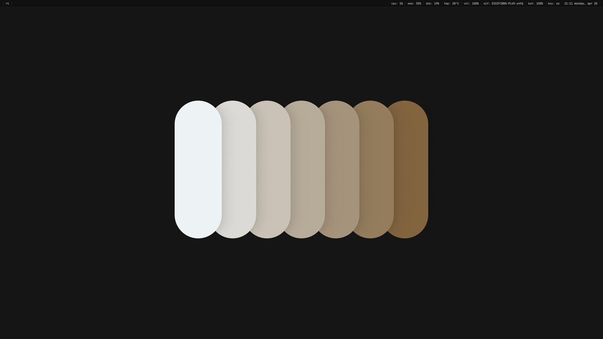

# Midcentury Dark



A warm, minimal, and highly structured Wayland configuration for Ubuntu 26.04.

**Midcentury Dark** strips away unnecessary visual noise, favoring a tactile, earthy color palette, sharp corners, and highly intentional spacing. Built entirely around Sway and Wayland-native tools, this setup is designed to get out of your way while remaining incredibly pleasing to look at.

## 🎨 The Aesthetic

The color palette is built on deep blacks, subtle grays, and warm, earthy accents to reduce eye strain while providing clear visual hierarchy. 

| Element | Color | Hex |
| :--- | :--- | :--- |
| **Background** | Deep Onyx | `#101010` |
| **Background (Alt)** | Raised Gray | `#252525` |
| **Borders** | Subtle Outline | `#303030` |
| **Foreground** | Warm White | `#f6f1ea` |
| **Accent** | Midcentury Wood | `#afa193` |

*Note: Critical alerts and custom terminal colors use complementary muted tones (like `#cc6666` for red and `#d8a657` for gold) to maintain the warm aesthetic.*

## ⚙️ Core Components

* **OS:** Ubuntu 26.04
* **Window Manager:** Sway (Wayland)
* **Bar:** Waybar (event-driven volume, pomodoro)
* **Launcher:** Rofi (Wayland fork)
* **Terminal:** Foot
* **Notifications:** Mako (snooze, live calendar reminders)
* **Lock screen:** swaylock-effects (built from source, patched)
* **Outputs:** Kanshi
* **Editor:** Neovim 0.12 (lazy.nvim)
* **Audio:** PipeWire + WirePlumber (filter chain for a Blue Snowball mic)
* **2FA:** `totp`, codes from age files unlocked by a YubiKey (FIDO2 hmac-secret)
* **Coding agent:** omp (config, theme, extensions, skills)
* **Font:** JetBrainsMono Nerd Font
* **Icons:** Papirus, GTK theme Yaru (brown accent, dark)

## 📦 Installation

```bash
git clone https://github.com/jaborvs/dotfiles.git ~/Documents/personal/repositories/dotfiles
cd ~/Documents/personal/repositories/dotfiles
./install.sh   # 3 = dependencies + deploy
```

Run it as your normal user; it calls `sudo` where needed and every step can be rerun safely.

* **Dependencies:** apt packages; the Chrome, Tailscale, NodeSource and HashiCorp apt repos; snaps; swaylock-effects; Oh My Zsh. User tools go to `~/.local`: Neovim, LuaLS, StyLua, shfmt, tree-sitter, age-plugin-fido2-hmac, uv, omp and context-mode. Downloads are pinned and checked against their SHA-256.
* **Deploy:** links everything under `home/` into `~` with [GNU Stow](https://www.gnu.org/software/stow/) (`--no-folding`, file by file). Existing files in the way are moved to `~/.dotfiles-backup-<date>/` first. Then it applies the GTK theme and enables the filter-chain user service.

### Layout

`home/` mirrors `$HOME`. Since the deployed files are symlinks into this repo, editing a config in place edits the repo; `git status` shows the drift. To track a new file, move it into `home/` at the same path and run `./install.sh` (option 2).

### Not in this repo

Secrets stay out:

* **SSH and commit signing key:** an `ed25519-sk` resident key on the YubiKey, so there is nothing to back up. On a new machine, plug in the key and run `cd ~/.ssh && ssh-keygen -K` (asks for the FIDO PIN) to recreate `id_ed25519_sk_rk_kaladin`. There is no ssh-agent: every connection and every signed commit asks for a fingerprint on the key.
* **OpenDev (temporary):** `review.opendev.org` runs Gerrit 3.13, whose Apache MINA 2.16 rejects FIDO signatures that carry the user-verified flag (this YubiKey always sets it). It gets its own passphrase-protected `~/.ssh/id_ed25519_opendev`, which is not backed up: on a new machine, generate a new one and register it in Gerrit. Drop it once OpenDev runs Gerrit 3.14 or later.
* `~/.local/share/totp/*.age` and `~/.config/totp/recipient`: restore from a private backup.

`~/bin/omp` sends omp's traffic through an HTTP proxy on a Tailscale node, found at startup with `tailscale ip -4 dalinar`. It refuses to start if the proxy is unreachable; `OMP_DIRECT=1 omp` bypasses it.
